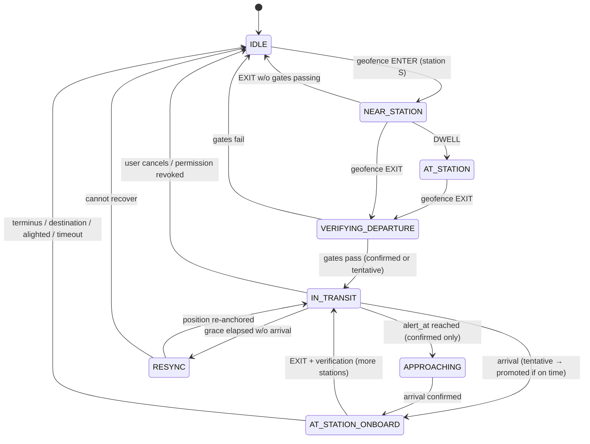

# IMPLEMENTATION.md — Onboard Train Detection & Next-Station Alerts

> **Audience:** AI coding agent working inside the existing Proximity Flutter codebase.
> **Feature:** Detect that the user is riding LRT-1, LRT-2, or MRT-3, then alert them as they approach each next station, using as few location fixes and as little network as possible.

---

## 0. Before you write any code

1. **Read the existing codebase first.** Identify and follow existing conventions for: state management, folder structure, routing, theming (monochrome glass UI; Poppins headers, Inter body), the Firebase client, and the existing proximity-alert / notification code. **Reuse, don't duplicate.**
2. **Inspect the existing stations / fare-matrix schema** in Cloud Firestore. Do not create parallel station collections. Extend the existing documents, or add a `transit_segments` collection only if something required is missing. Firestore stores precomputed geometry/timing values; spatial calculations remain on-device.
3. **Check pub.dev for current maintenance status** of every package suggested below before adding it. If a package is unmaintained or incompatible with the project's Flutter/AGP versions, write a small Kotlin bridge instead.
4. **Android-first.** Keep all platform-specific code behind interfaces (see §4) so iOS can be added later. Note iOS constraints in §9, but do not block on them.
5. Work in the milestones in §14. Commit after each. Do not skip the debug/simulation tooling (§13). It is required, because this feature cannot be tested by sitting at a desk.

---

## 1. Goal & non-goals

### Goal
When the user is on an LRT-1 / LRT-2 / MRT-3 train, the app tells them **"Approaching `<Station>`"** shortly before each station and tracks which station they are currently at, without polling GPS every second and without needing the network during the ride.

### Non-goals (v1)
- Real-time train positions / schedules / crowding (no network dependency).
- Turn-by-turn or map-following UI during the ride. A map is optional and must not be required.
- Buses, jeepneys, UV Express, PNR.
- Crowd-sourced calibration upload (leave a clearly marked hook only).
- Wear OS / widgets.

---

## 2. Core idea (the user's concept, tightened)

Stations are treated as **invisible markers (geofences)**. The app stays idle and cheap until the user passes a station, and only then does short bursts of location work.

```
IDLE (OS geofences only, near-zero cost)
  → user enters a station's marker and lingers          = "at station S"
  → user leaves it fast, heading along the line         = "boarded, direction D"
  → app takes 1 GPS fix, computes ETA to next station   = timer + distance
  → (optional) 1 correction fix at ~60% of the ETA      = fixes drift
  → approach alert fires ~60 s before arrival           = "Approaching X"
  → user reaches within 50 m of X                       = arrival confirmed
  → X becomes the current station, wait for departure   = loop
```

### Key refinements over the original idea (do not undo these)

| # | Original | Refinement | Why |
|---|----------|-----------|-----|
| 1 | "Don't use much data" | Location fixes use **battery, not mobile data**. The real constraints are battery and background limits. Network use during a ride must still be **zero**: all station/line data is local. | Avoids optimizing the wrong thing. |
| 2 | 50 m geofence | Register OS geofences at **150 m** (`STATION_WAKE_RADIUS_M`) and treat **50 m** as the *logical* arrival radius, verified by a single fix. | Android's geofencing is unreliable below ~100 m, and GPS in the urban canyon along Taft/EDSA is 10–30 m off. |
| 3 | Notify at 50 m from next station | Notify based on **time-to-arrival** (default 60 s ≈ 500–700 m at train speed) using a scheduled local notification. 50 m is only used to confirm arrival. | At ~40 km/h, 50 m is ~4 s before the stop, which is too late to be useful. |
| 4 | Pure timer | Timer is **re-anchored by position** with at most 1–2 single-shot fixes per segment, plus an OS geofence on the next station as a safety net. | Trains stall; pure timers drift and false-fire. |
| 5 | Geofence = onboard | Geofence entry only means *near a station*. Boarding requires **dwell + speed + heading along the line**, scored for confidence (§6.2). | Passing pedestrians and parallel road traffic (Taft Ave runs under LRT-1) would otherwise false-trigger. |

---

## 3. Glossary

- **Line:** LRT-1, LRT-2, or MRT-3 (data-driven; do not hardcode station lists. LRT-1 has had extension stations added).
- **Station node:** one station *on one line*. Interchange complexes (e.g., Doroteo Jose/Recto, EDSA/Taft, Araneta Center-Cubao, North Avenue/Quezon Ave) are **separate nodes per line** linked via `interchange_with`.
- **Segment:** an ordered pair of adjacent station nodes on the same line (directional lookups use the same record).
- **Direction:** toward one of the line's two termini. Defined per line by `order_index` increasing or decreasing.
- **Ride session:** one continuous trip on one line. Persisted locally.
- **Wake geofence:** OS-level geofence (150 m) used to wake the app. **Arrival radius:** 50 m logical check done by app code.

---

## 4. Architecture

Create a feature module (adapt names to repo conventions):

```
lib/features/ride_tracking/
  domain/
    models/            station.dart, train_line.dart, segment.dart, ride_session.dart, ride_state.dart
    ride_state_machine.dart       # PURE Dart. No Flutter/plugin imports. Injectable clock.
    boarding_detector.dart        # confidence scoring (§6.2)
    direction_resolver.dart       # bearing math (§6.3)
    eta_estimator.dart            # (§6.4)
    geo_utils.dart                # haversine, bearing, point-to-segment projection
  data/
    station_repository.dart       # reads local cache; syncs from Firestore only on version change
    segment_timing_store.dart     # local calibration (EMA) per segment/line
    ride_session_store.dart       # persists the active session (survives process death)
    ride_log_store.dart           # local-only ride history for tuning/debug
  platform/
    geofence_service.dart         # interface + Android impl
    location_service.dart         # interface: single-shot getFix(timeout, accuracy)
    activity_service.dart         # interface (optional signal): IN_VEHICLE / WALKING / STILL
    alert_scheduler.dart          # interface: schedule/cancel exact local notification
    ride_foreground_service.dart  # Android foreground service wrapper
  presentation/
    ride_banner.dart / ride_sheet.dart
    ride_settings_section.dart
    ride_debug_screen.dart        # §13 (debug builds only)
  ride_config.dart                # ALL tunable constants (§10)
  ride_controller.dart            # wires state machine ↔ platform services ↔ UI state
```

**Rules**
- `ride_state_machine.dart` and everything in `domain/` must be unit-testable with no platform dependencies. Time comes from an injected `Clock`.
- The controller must be re-creatable inside a **background isolate / service** and restore from `ride_session_store` (the app process may be killed mid-ride).
- No `print`; use the project's logger. Log every state transition with a reason (also stored in `ride_log_store` in debug builds).

### Suggested packages (verify first, see §0.3)
- Geofencing in background isolate: `native_geofence` (or a custom Kotlin `GeofencingClient` bridge).
- Single-shot GPS: `geolocator` (`getCurrentPosition` with timeout).
- Foreground service: `flutter_foreground_task` or `flutter_background_service`.
- Local notifications (exact, survives app death): `flutter_local_notifications` with `zonedSchedule` + `exactAllowWhileIdle`.
- Optional activity recognition: `activity_recognition_flutter` or a Kotlin bridge to the Activity Recognition Transition API.
- Local persistence: whatever the project already uses (Drift/sqflite/Hive/SharedPreferences). Don't add another.

---

## 5. Data

### 5.1 Local station data (no network during a ride)

- Bundle a seed `assets/transit/stations.json` **and** keep a local SQLite cache. On app start, if online *and* `transit_config/current.version` in Firestore differs from local, pull `transit_stations` once and atomically replace local data. Never fetch during an active ride.
- Generate the seed from the existing Firestore `transit_stations` collection. **Verify coordinates against a map** for a few stations before trusting them (stations should sit on the track, not the street entrance).
- Firestore layout: `transit_config/current` contains `version`; each `transit_stations/{stationId}` document uses the station-node fields below; optional `transit_segments/{fromId_toId}` documents use the segment fields below. Transit data is globally readable to authenticated users and writable only by trusted backend/admin tooling.

```jsonc
// station node
{
  "id": "lrt1_doroteo_jose",
  "line_id": "LRT1",
  "name": "Doroteo Jose",
  "order_index": 17,
  "lat": 0.0, "lng": 0.0,                  // platform/track-side centroid
  "wake_radius_m": null,                   // null = use default (150)
  "arrive_radius_m": null,                 // null = use default (50); allow per-station override
  "interchange_with": ["lrt2_recto"]
}
// line
{ "id": "LRT1", "name": "LRT-1", "terminus_low": "<name>", "terminus_high": "<name>" }
// segment (precomputed, bidirectional)
{
  "from_station_id": "...", "to_station_id": "...",
  "track_distance_m": 0,                   // precompute during admin import from track geometry; fallback on-device to haversine × 1.10
  "bearing_deg": 0,                        // from→to
  "typical_moving_s": 0,                   // seed = track_distance_m / DEFAULT_CRUISE_MS
  "polyline": "<optional encoded polyline>"
}
```

If track geometry is available to the Firebase admin/import pipeline, store a simplified encoded polyline on the segment document for projecting GPS fixes onto the track (§6.4). If not, project onto the straight segment between the two stations.

### 5.2 Local calibration
`segment_timing_store`: per `segment_id` store `cruise_speed_ms` (EMA, α = `EMA_ALPHA`) with a per-line fallback. Updated after every confirmed segment (§6.7). Local only.

### 5.3 Ride session (persisted after every transition)
```
RideSession {
  id, line_id, direction (+1/-1),
  state, confirmed (bool),
  current_station_id, next_station_id,
  departed_at, eta_at, alert_at,
  fixes_used_this_segment,
  origin: auto | manual | planned_trip,
  destination_station_id?   // optional
}
```

---

## 6. Behavior in detail

### 6.1 Idle: OS geofence ring (cheap)

- Register OS geofences (ENTER | EXIT | DWELL, `loiteringDelay = DWELL_LOITER_MS`) at `STATION_WAKE_RADIUS_M` for only the **nearest N stations** (`GEOFENCE_RING_SIZE`, default 15, so it also fits iOS's 20-region cap) plus **one "recenter" geofence** (radius `RECENTER_RADIUS_M`, ~2 km) around the last known position.
- On recenter EXIT (and on app start / device reboot / location-setting change), recompute the nearest N stations and re-register. Geofences are cleared on reboot, so re-register on `BOOT_COMPLETED`.
- Set the **lowest acceptable notification responsiveness** (Android default latency can be large; target ≤ ~30 s).
- If the user disables the feature or revokes permissions, remove all geofences.

### 6.2 Boarding detection (confidence-scored, not geofence alone)

Flow:
1. **ENTER** station S wake geofence → state `NEAR_STATION(S)`. Nothing else happens (no fixes).
2. **DWELL** event (user stayed ≥ `DWELL_LOITER_MS`) → state `AT_STATION(S)`; mark `dwell=true`. (Dwell is optional but boosts confidence. Pedestrians walking past never dwell.)
3. **EXIT** from S's wake geofence → schedule **one** verification fix `DEPARTURE_VERIFY_DELAY_S` (~25 s) later. Compute displacement and speed between the EXIT trigger location and that fix.
4. Evaluate:

**Hard gates (all must pass):**
- G1: Was in `NEAR_STATION`/`AT_STATION` for a station within the last `DEPARTURE_WINDOW_S`.
- G2: Average speed ≥ `MIN_TRAIN_SPEED_MS` (~6 m/s ≈ 22 km/h; walking is ~1.4 m/s).
- G3: Movement bearing within `HEADING_TOLERANCE_DEG` of a line direction from S (see §6.3).

**Boosters (each +1):** `dwell`; activity = `IN_VEHICLE` (if available); a planned trip / destination uses this line; manual "I'm on the train" (counts as definitive, skip scoring).

**Outcome:**
- Gates fail → back to `IDLE`.
- Gates pass, boosters ≥ `AUTO_CONFIRM_BOOSTERS` (default 2) → start session `confirmed = true`, silently.
- Gates pass, boosters < threshold → start session `confirmed = false` (**tentative**) and post a quiet notification: *"Riding LRT-1 toward `<terminus>`? [Yes] [No]"*.
  - **Yes** → `confirmed = true`. **No** → cancel the session, return to `IDLE`.
  - **No response** → continue tentatively and **validate at the next station**: arriving within ±`TENTATIVE_ETA_TOLERANCE` (40%) of the ETA promotes to `confirmed`; otherwise cancel silently without ever alerting.
  - A tentative session must **not** fire "Approaching" alerts. Only the quiet confirm prompt. (Prevents false alerts on jeeps along Taft.)

### 6.3 Line & direction resolution

For each candidate line at station S (interchange stations have several), compute the bearings from S to its two neighbors (`prev`, `next`). Compare the observed movement bearing to each. Pick the candidate with the smallest angular difference that is within `HEADING_TOLERANCE_DEG`.
- Tie / ambiguity (e.g., at an interchange, or two candidates within 15° of each other) → ask the user via the confirm notification with both options.
- Terminus stations have one neighbor; only one direction is valid.
- Use bearing to the neighbor station, **not** a fixed compass direction. The lines curve.

### 6.4 ETA estimation (distance + timer, position re-anchored)

At the verification fix (time `T_fix`, position `P`):
1. Project `P` onto the track (polyline, or the straight segment) to get `along_m` from S. Reject the fix if `accuracy > MAX_FIX_ACCURACY_M` and retry once; if it fails, fall back to `along_m = distance moved estimate = speed × elapsed`, or just use the full segment from the departure time.
2. `d_remaining = segment.track_distance_m − along_m` (clamp ≥ 0).
3. `v_cruise` = segment's calibrated cruise speed, else line fallback, else `DEFAULT_CRUISE_MS`.
4. `ETA = T_fix + d_remaining / v_cruise + BRAKE_ALLOWANCE_S`.
5. `alert_at = ETA − approach_lead_time (user setting, default 60 s)`; if that is already in the past (very short segment), alert immediately at `T_fix + MIN_ALERT_DELAY_S`.

> Do **not** use the instantaneous speed at the verification fix as cruise speed. The train is still accelerating. Use it only as a sanity check (≥ `MIN_TRAIN_SPEED_MS`).

Schedule:
- A **guaranteed exact local notification** at `alert_at` via `alert_scheduler` (works even if the app process dies). Use a stable notification id so it can be cancelled/rescheduled.
- A Dart `Timer` inside the foreground service only for updating the ongoing notification text; never rely on it for the alert itself.

### 6.5 Correction fix (bounded polling)

At `T_departure + CORRECTION_FIX_AT_FRACTION × (ETA − T_departure)` (default 60%):
1. Take **one** single-shot fix (`FIX_TIMEOUT_S`, balanced-high accuracy). Count it in `fixes_used_this_segment` (cap = `MAX_FIXES_PER_SEGMENT`, default 2 including the verification fix).
2. Project onto the track and recompute `d_remaining`, then **ETA and `alert_at`**; cancel and reschedule the notification.
3. Sanity checks:
   - Progress ≈ 0 for a long time (stall / signal hold): push ETA out by the stall duration; do not alert early.
   - Negative progress / bearing reversed: wrong direction assumed → flip the direction once; if still inconsistent → cancel the session (§6.8).
   - Fix fails (no GPS, tunnel, timeout): keep the previous ETA and continue. **Never retry in a loop.**

### 6.6 Approach alert & next-station safety net

- During the segment, register OS geofences for the **next station** (150 m wake) and the one after it (for resync).
- **Approach alert** fires from the scheduled notification at `alert_at`: *"Approaching `<Next>` · ~1 min"*, with high-priority channel + vibration. If the app is foregrounded, also show the in-app banner.
- **Safety net:** if the next-station geofence ENTER occurs and the approach alert has *not* fired yet (timer was too slow), fire it immediately.
- Never fire the approach alert twice for the same segment (guard by `segment_alert_sent`).

### 6.7 Arrival & advance

Arrival is confirmed when **either**:
- next-station wake geofence ENTER, then one fix shows distance to station ≤ `STATION_ARRIVE_RADIUS_M` (50 m), **or**
- ENTER, then `ARRIVAL_SETTLE_S` (~15 s) passes with no further info (GPS unreliable near elevated stations), **or**
- fallback: `ETA + ARRIVAL_GRACE_S` elapses with no geofence event, then do **one** fix to resync (§6.8).

On arrival:
1. `current_station = next_station`. Update the ongoing notification: *"At `<Station>` · next: `<Next>`"*.
2. Record the actual segment time: `v_actual = segment.track_distance_m / (arrival_time − departure_time − dwell_correction)`; update the EMA for the segment and line. Only update for a **confirmed** session and sane values (within 0.5×–2× of the prior).
3. If `Station == destination` or is the **terminus** in the current direction → notify *"You've arrived at `<Station>`"* / *"End of line"*, end the session (offer "transfer to `<other line>`" at interchanges).
4. Otherwise choose the next neighbor, re-register geofences for `next` and `next+1`, enter `AT_STATION_ONBOARD`, and **wait for the EXIT event** to start the next segment timer. (Departure is detected by the geofence EXIT; **no polling while stopped**.) On EXIT take one verification fix (like §6.4) to re-anchor.

### 6.8 Drift, resync & alighting

| Situation | Handling |
|-----------|----------|
| Next-station geofence never triggers by `ETA + ARRIVAL_GRACE_S` | One fix → project onto the line → set `current_station` to the nearest station *behind or at* the position, recompute next/ETA. If the fix fails, extend the grace once, then end the session quietly. |
| User alights at an intermediate station | After arrival, an EXIT whose verification fix shows speed < `MIN_TRAIN_SPEED_MS` or bearing off-line → end session, return to `IDLE`. |
| User stays at station with no departure for `RIDE_IDLE_TIMEOUT_MIN` | End session (assume alighted). |
| Train stalls between stations | See §6.5 sanity checks. |
| App killed / device rebooted mid-ride | On restart restore `ride_session_store`; if `eta_at` is far in the past, run a single resync fix; otherwise continue. Re-register geofences. |
| GPS unavailable (tunnel/underground portions, indoor) | Keep timer-based ETA; no retries; notification text indicates "estimated". |
| User manually corrects line/direction/station | Apply immediately, recompute, mark `origin = manual`, `confirmed = true`. |
| Location permission revoked mid-ride | End session; post a notification explaining why. |

### 6.9 Manual mode & planned trips (fallbacks, build these too)

- **"I'm on the train" button** (in the ride sheet and the Sakay/route-result screen): user picks line + direction + current station (defaulting to the nearest station). Works with GPS off; a purely timer-based ride using local data. Same state machine from `IN_TRANSIT`.
- **Planned trip integration:** if the user has an active Sakay/route plan with an LRT/MRT leg, treat the plan as a booster and let the ride auto-end at the planned destination station. (Integrate through the existing route model; don't call the network.)

---

## 7. State machine (summary)



Implement as a pure reducer: `(state, event, now) → (newState, effects[])` where `effects` are things like `RegisterGeofences`, `TakeFix`, `ScheduleAlert`, `CancelAlert`, `PostNotification`, `PersistSession`. The controller executes effects. This makes the whole flow unit-testable.

**Events:** `GeofenceEnter(stationId, loc, t)`, `GeofenceDwell`, `GeofenceExit`, `FixResult(loc, accuracy, t)`, `FixFailed`, `AlertTimerDue`, `ArrivalGraceElapsed`, `UserConfirm(yes/no)`, `UserManualStart`, `UserCancel`, `ActivityChanged`, `PermissionChanged`, `AppRestored`.

---

## 8. Notifications & UI

### Notifications (all local)
- **Ongoing (foreground service) notification**, shown only while a session is active: `LRT-1 → <terminus> · Next: <Station> (~2 min)`. Update on state changes, not every second. Actions: *Not on a train*, *Wrong direction*.
- **Confirm prompt** (tentative boarding): quiet/low importance, with Yes/No actions.
- **Approach alert:** high-importance channel `ride_approach`, vibration pattern, heads-up, shows on lock screen: *"Approaching `<Station>`"*.
- **Arrival / end-of-line / destination** notification: default importance.
- All strings go through the app's localization system.

### In-app UI (minimal, match the monochrome glass design)
- **Ride sheet / banner** (visible when a session exists): line chip, `Current → Next`, ETA label (e.g., "~2 min", marked "est." if GPS-less), remaining stops to destination if set. Countdown updates from a local timer **only while the app is foregrounded**.
- Buttons: *I'm not on a train*, *Wrong line/direction*, *Set destination*.
- **Settings section "Train ride alerts":**
  - Master toggle (off by default until permission flow completes).
  - Alert lead time: 30 s / 1 min (default) / 2 min.
  - Alert style: vibrate only / sound + vibrate.
  - "Auto-detect boarding" toggle (off → manual mode only).

### Permission flow (stepwise, with rationale screens)
1. Foreground location → 2. Notifications (Android 13+) → 3. Background location ("Allow all the time"), with an in-app explanation that location is used only near stations, **processed on-device and never uploaded** → 4. Exact alarm permission if required → 5. (Optional) Activity recognition.
Handle every denial gracefully: fall back to manual mode and say what is limited.

---

## 9. Platform notes

### Android
- Manifest: `ACCESS_FINE_LOCATION`, `ACCESS_COARSE_LOCATION`, `ACCESS_BACKGROUND_LOCATION`, `FOREGROUND_SERVICE`, `FOREGROUND_SERVICE_LOCATION` (declare the service `foregroundServiceType="location"`), `POST_NOTIFICATIONS`, `SCHEDULE_EXACT_ALARM` or `USE_EXACT_ALARM` (follow current Play policy for the app's category), `RECEIVE_BOOT_COMPLETED`, optional `ACTIVITY_RECOGNITION`.
- Foreground service runs **only during an active session** (not while IDLE).
- Geofence limit is 100 per app; we use ~16. Google recommends ≥100 m radius for reliable geofences, which is why the OS ring is 150 m.
- Geofences are dropped on reboot or when location is toggled; re-register on boot and on `PROVIDERS_CHANGED`.
- OEM battery killers (Xiaomi/Oppo/Vivo/Samsung): add an optional help screen linking to battery-optimization exemption; do not nag.

### iOS (later)
- Region monitoring cap is **20**; keep `GEOFENCE_RING_SIZE + 1 ≤ 20`.
- No foreground service; rely on region events waking the app (~10 s of runtime), then single-shot fix + scheduled local notifications (schedule the approach alert *ahead of time* from the ETA, update on correction).
- Requires "Always" location + `UIBackgroundModes: location`.

---

## 10. `ride_config.dart` (all tunables in one place)

```dart
class RideConfig {
  // Geometry
  static const stationWakeRadiusM = 150;        // OS geofence radius
  static const stationArriveRadiusM = 50;       // logical arrival radius (fix-verified)
  static const recenterRadiusM = 2000;
  static const geofenceRingSize = 15;

  // Boarding detection
  static const dwellLoiterMs = 30000;
  static const departureVerifyDelayS = 25;
  static const departureWindowS = 180;
  static const minTrainSpeedMs = 6.0;           // ~22 km/h
  static const headingToleranceDeg = 40;
  static const autoConfirmBoosters = 2;
  static const tentativeEtaTolerance = 0.40;

  // ETA / timing
  static const defaultCruiseMs = 9.7;           // ~35 km/h seed; calibrate from real rides
  static const brakeAllowanceS = 15;
  static const emaAlpha = 0.3;
  static const correctionFixAtFraction = 0.60;
  static const maxFixesPerSegment = 2;
  static const fixTimeoutS = 12;
  static const maxFixAccuracyM = 80;

  // Alerts
  static const defaultApproachLeadS = 60;
  static const minAlertDelayS = 5;

  // Arrival / recovery
  static const arrivalSettleS = 15;
  static int arrivalGraceS(int etaSegmentS) => max(45, (0.4 * etaSegmentS).round());
  static const rideIdleTimeoutMin = 10;
}
```

Treat these as **starting values to be tuned from real rides** (see §13 ride log), not truths. `defaultCruiseMs` especially needs real-world calibration per line.

---

## 11. Data-usage & battery rules (enforce in code review)

1. **Zero network calls during an active ride.** No Firestore, no map tiles, no analytics. Queue anything for later.
2. Station data sync: only on app start, only if the version changed, never in the background service.
3. **No continuous location streams.** Only: OS geofence callbacks, and single-shot fixes (max `MAX_FIXES_PER_SEGMENT` per segment, always with a timeout, never retried in a loop).
4. Foreground service exists only while a session is active; stop it on session end.
5. Update the ongoing notification only on state changes or minute boundaries.
6. Location data and ride logs stay on-device. No upload in v1.

Target: ≤ 2 GPS fixes per segment, 0 bytes of mobile data per ride.

---

## 12. Edge cases checklist

- Interchange stations (several candidate lines, separate platforms/nodes).
- Terminus arrival and immediate reverse departure (train turnaround; do not auto-start a new ride without fresh gates).
- User boards, then immediately gets off (dwell, tiny movement) → gates fail → `IDLE`.
- User rides past their destination: alert behavior unchanged; destination arrival message still fires if destination set.
- Two stations whose wake geofences overlap (close stations / interchange pairs): resolve by line direction and expected `next_station`; ignore geofence events for stations not expected next (except for resync).
- Clock changes / timezone changes: use monotonic time for timers; wall-clock only for display and scheduling.
- Low power mode / Doze: rely on exact scheduled notifications for the alert.
- Feature toggled off mid-ride: cancel everything cleanly (geofences, alarms, service).
- Stations added/removed in a data update: rebuild segments; never crash on a missing station id in a stored session (end the session instead).

---

## 13. Testing & debug tooling (required)

1. **Unit tests (pure Dart):** state machine transitions, boarding gates/boosters, direction resolver (including interchanges and termini), ETA math, track projection, EMA calibration, grace/resync logic. Use an injected fake clock.
2. **Simulator:** a debug-only "Simulate ride" tool that feeds scripted events (`GeofenceEnter/Dwell/Exit`, `FixResult` with noise, stalls, GPS dropouts) with **time compression** (e.g., 20×) along a chosen line/direction. Include scenarios: normal ride, stall mid-segment, missed geofence, wrong direction, jeepney false positive (high speed but no dwell → tentative → cancelled), alight mid-line, app restart mid-ride.
3. **GPX/mock-location replay** on a device/emulator for end-to-end checks of the Android integration.
4. **Debug screen (debug builds only):** current state, session JSON, registered geofences, last events with timestamps, fixes used per segment, ETA vs actual, ability to force events.
5. **Local ride log** (`ride_log_store`): per segment `planned_eta`, `actual_arrival`, fixes used, confidence signals. This is how constants get tuned after real rides. Provide a debug "export log" button (share sheet, manual only).
6. **Field test script** (document in the PR): ride one full line each direction; record missed/late/early alerts, false boardings, battery % per hour.

---

## 14. Milestones

### M1 — Foundations
- [ ] Inspect repo/schema; note conventions in a short `ride_tracking/NOTES.md`.
- [ ] Models, `RideConfig`, `geo_utils`, `station_repository` (local cache + version sync), segment precompute.
- [ ] Unit tests for geo utils and repository.

### M2 — Pure logic
- [ ] `ride_state_machine` reducer with effects, `boarding_detector`, `direction_resolver`, `eta_estimator`, calibration store.
- [ ] Full unit-test suite + simulator scenarios (§13.1–13.2) passing.

### M3 — Platform integration (Android)
- [ ] Permission flow + rationale screens.
- [ ] Geofence ring management + recenter + boot re-registration.
- [ ] Single-shot location service, exact local notification scheduler, foreground service, session persistence/restore.
- [ ] `ride_controller` wiring everything.

### M4 — UX
- [ ] Ongoing + confirm + approach + arrival notifications and channels.
- [ ] Ride sheet/banner, settings section, manual "I'm on the train" mode, planned-trip hook.
- [ ] Debug screen and ride log.

### M5 — Hardening
- [ ] All §12 edge cases covered by a test or a documented manual check.
- [ ] Battery and network audit against §11.
- [ ] Field-test notes; tune `RideConfig` values.

---

## 15. Acceptance criteria

- With the app backgrounded/killed and the screen locked, a confirmed ride yields an **"Approaching `<Station>`"** notification roughly `approach_lead` seconds before arrival (±30 s on a normal segment) at each station for a full line in each direction.
- `current_station` advances correctly at every stop, including after one deliberately stalled segment and one GPS-less segment.
- Walking past a station, or riding a jeepney alongside the line, **does not** produce approach alerts.
- Interchange boarding resolves to the correct line/direction or asks the user once.
- ≤ 2 GPS fixes per segment; **0 network requests** during a ride (verify via logs/network inspector).
- Foreground service and geofences are cleaned up when a session ends or the feature is disabled.
- Killing the app and rebooting mid-ride recovers into a sane state without a crash or duplicate alerts.
- All unit tests and simulator scenarios pass; `flutter analyze` clean.

---

## 16. Future (do not build now; leave hooks)

- Opt-in, anonymized upload of segment timings to refine `typical_moving_s` for everyone.
- "Wake-me-up" alarm mode for a chosen destination (louder, repeating).
- Door-side/exit hints, per-station platform info, and transfer guidance.
- Wear OS / Live Activity (iOS) presentation of the ongoing ride state.
